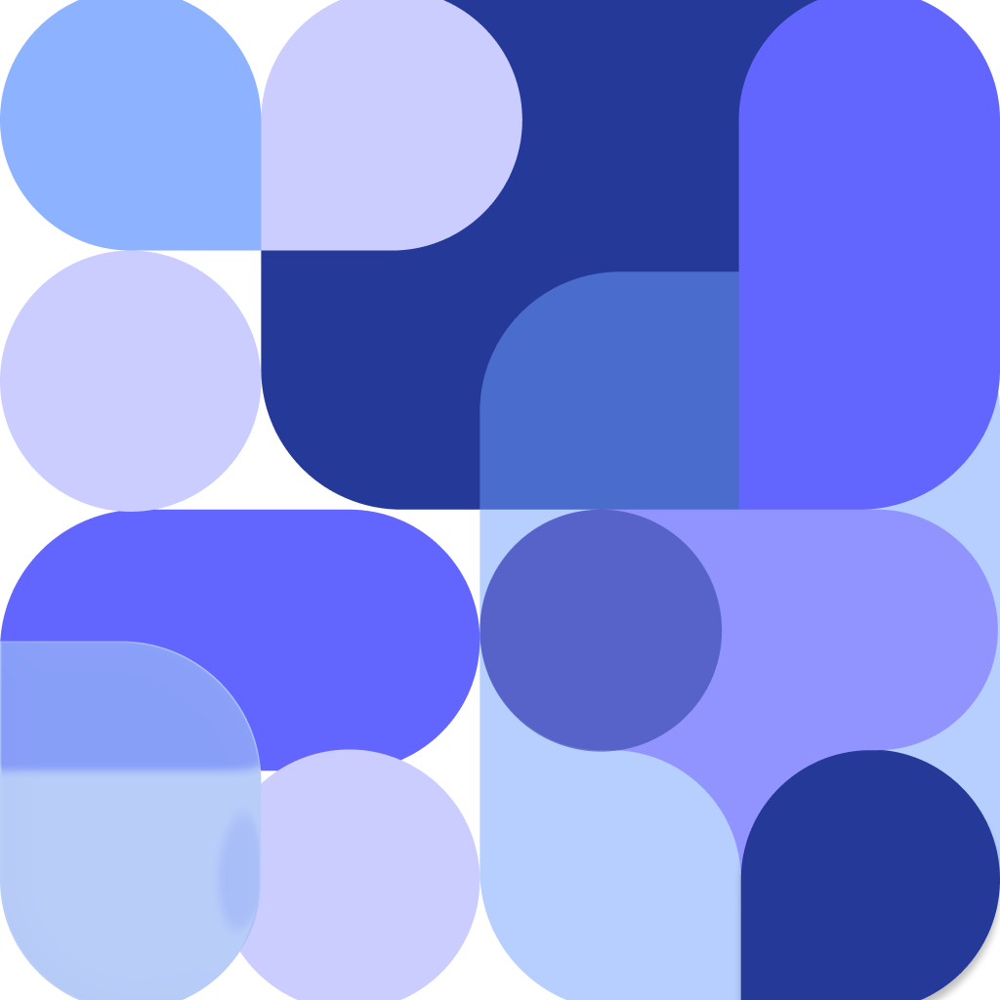

<div align="center">



# ReUne

[](https://developer.apple.com/ios/)
[](https://swift.org)
[](https://developer.apple.com/xcode/swiftui/)
[](https://developer.apple.com/icloud/cloudkit/)
[](LICENSE)

Coordinate plans and social get-togethers effortlessly: create groups, propose activities, vote on schedules, and reach group consensus in real time.

<a href="https://apps.apple.com/br/app/reune-junte-seus-amigos/id6771074080">
  
</a>

</div>

## Table of Contents

- [About](#about)
- [Features](#features)
- [Built With](#built-with)
- [Getting Started](#getting-started)
- [Project Structure](#project-structure)
- [Team](#team)
- [License](#license)

## About

**ReUne** was developed at the Apple Developer Academy | Mackenzie to eliminate the friction of organizing group plans. Deciding where to go, what activity to do, and when everyone is available often results in chaotic group chats and stalled plans.

ReUne provides a streamlined, collaborative experience where users create event groups, suggest activities categorized by vibe or type, cast votes on proposed dates and times, and visualize the group's collective preferences through an animated consensus timeline and interactive word cloud. Built natively with SwiftUI and Apple CloudKit, all changes sync across members with push notification alerts.

## Features

- **Collaborative Group Creation:** Set up event groups with custom covers, categories, and invite contacts seamlessly.
- **Activity Proposal & Voting:** Members propose outings, dinner ideas, or events and vote interactively.
- **Consensus Scheduling & Timeline:** Aggregate member availability to highlight the most-voted date and time slots on a unified calendar.
- **Dynamic Word Cloud:** Visual representation of the group's favorite suggestions and preferences.
- **Real-Time CloudKit Sync:** Live updates across all group participants backed by Apple CloudKit Private and Shared databases.
- **Push Notifications:** Instant alerts for new group invitations, voting deadlines, and final schedule consensus.
- **Monetization & Analytics:** Integrated with Google Mobile Ads (AdMob), StoreKit in-app purchases, and Aptabase privacy-first telemetry.

## Built With

- **SwiftUI** with MVVM architecture
- **CloudKit** for decentralized data synchronization and authentication
- **UserNotifications** for local and remote APNs notifications
- **Aptabase SDK** for privacy-preserving usage analytics
- **Google Mobile Ads (AdMob)** for banner and interstitial ads
- **StoreKit 2** for in-app purchases and subscriptions

## Getting Started

### Requirements

- Xcode 15 or later
- iPhone with iOS 17 or later
- Active Apple Developer account (for CloudKit container capabilities and Push Notifications)

### Installation & Run

```bash
git clone https://github.com/hyauss/ProjectChallenge13.git
cd ProjectChallenge13
open ProjectChallenge13/ProjectChallenge13.xcodeproj
```

1. Select your target device or simulator.
2. Under **Signing & Capabilities**, select your development team.
3. Ensure the iCloud container (`iCloud.br.com.ReUne`) and Push Notifications capabilities are configured with your team id.
4. Press **Run** (`Cmd + R`).

## Project Structure

```
ProjectChallenge13/ProjectChallenge13/
├── ProjectChallenge13App.swift     Application lifecycle and SDK initialization
├── Models/
│   ├── GroupModel.swift            Event group, categories, and activity entities
│   ├── FormModel.swift             Voting form schema and choices
│   ├── PreferenceModel.swift       User availability and preference options
│   └── WordElement.swift           Word cloud geometry and weight model
├── ViewModels/
│   ├── GroupViewModel.swift        Group state management and CloudKit interactions
│   ├── LoginViewModel.swift        Apple ID and CloudKit user authentication
│   ├── PushNotificationViewModel.swift Remote notifications subscription
│   └── AdManager.swift             Google Mobile Ads coordination
├── Views/
│   ├── HomeView.swift              Dashboard listing active groups and invitations
│   ├── NewGroup/                   Group creation sheets, category pickers, contact cards
│   ├── GroupResult/                Consensus timeline, most voted hours, calendar view
│   ├── Form/                       Activity suggestion and voting forms
│   ├── WordCloudView.swift         Dynamic interactive word cloud
│   └── Components/                 Group cards, shimmer modifiers, custom buttons
└── Assets.xcassets/                App icon, illustrations, dark/light covers, color sets
```

## Team

<div align="center">
  <table>
    <tr>
      <td align="center" width="20%">
        <a href="https://github.com/hyauss"></a>
        <br/><sub><b>Vinicius Marques</b></sub><br/><br/>
        <a href="https://github.com/hyauss"></a>
        <a href="https://www.linkedin.com/in/vinicius-marques-966918274/"></a>
      </td>
      <td align="center" width="20%">
        <a href="https://github.com/carolssun"></a>
        <br/><sub><b>Carolina Sun</b></sub><br/><br/>
        <a href="https://github.com/carolssun"></a>
        <a href="https://www.linkedin.com/in/carolina-sun/"></a>
      </td>
      <td align="center" width="20%">
        <a href="https://github.com/LosadaT"></a>
        <br/><sub><b>Francisco Totaro</b></sub><br/><br/>
        <a href="https://github.com/LosadaT"></a>
        <a href="https://www.linkedin.com/in/francisco-losada-totaro/"></a>
      </td>
      <td align="center" width="20%">
        <a href="https://github.com/OliveiraRNeves"></a>
        <br/><sub><b>Rafael Neves</b></sub><br/><br/>
        <a href="https://github.com/OliveiraRNeves"></a>
        <a href="https://www.linkedin.com/in/rafael-oneves/"></a>
      </td>
      <td align="center" width="20%">
        <a href="https://github.com/Anshushu000"></a>
        <br/><sub><b>Anshu Li</b></sub><br/><br/>
        <a href="https://github.com/Anshushu000"></a>
        <a href="https://www.linkedin.com/in/anshu-li/"></a>
      </td>
    </tr>
  </table>
</div>

## License

Released under the [MIT License](LICENSE). Copyright (c) 2026 Vinicius Marques, Carolina Sun, Francisco Totaro, Rafael Neves and Anshu Li.
